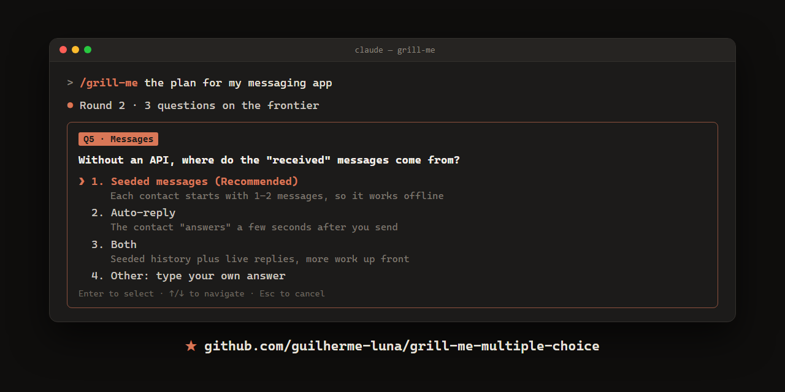

# grill-me (multiple choice)

[](https://claude.com/claude-code)
[](LICENSE)
[](https://github.com/guilherme-luna/grill-me-multiple-choice/stargazers)



🇧🇷 **[Leia em português](#-português)** · 🇪🇸 **[Leer en español](#-español)**

A Claude Code plugin that interviews you about a plan, one clickable multiple-choice round at a time.

It is based on the `grill-me` skill by Matt Pocock (MIT), but every round uses Claude Code's `AskUserQuestion` tool, so it works in Claude Code only. The original keeps questions as plain text so it runs in any harness. The divergence is deliberate.

Install is one command, with no config to edit.

Clickable questions have been requested several times upstream ([#798](https://github.com/mattpocock/skills/issues/798), [#643](https://github.com/mattpocock/skills/issues/643)), but they depend on the harness, so they stay out of the official skill. This repo packages them as a ready-to-install plugin. The original is [`grill-me`](https://github.com/mattpocock/skills/tree/main/skills/productivity/grill-me) by [Matt Pocock](https://github.com/mattpocock), MIT licensed.

## What's different

The original skill asks each round as plain text, with a recommended answer you accept by typing "yes". This version makes every round use Claude Code's `AskUserQuestion` tool:

| | Original | This version |
|---|---|---|
| How questions appear | Text in the chat | Selection dialog |
| Answer options | Free text | a, b, c, plus d (Other) for your own answer |
| Recommendation | `➡️` line after the question | First option, marked `(Recommended)` |
| Trade-offs | Inline in the question | Short description under each option |
| Numbering | Per round | Continues across rounds (Q1…Q12…) |
| Language | Not covered | Follows the user's language |

The rest is unchanged: the design tree, the frontier of questions that can be asked now, Claude looking up facts on its own, and nothing being done until you confirm a shared understanding.

### Why not just a `CLAUDE.md` snippet?

You can get clickable rounds by adding a few lines to your `CLAUDE.md` (see [#798](https://github.com/mattpocock/skills/issues/798)). That works well if you're comfortable editing config. This plugin is for when you'd rather:

- install it with one command and remove it just as easily;
- keep your `CLAUDE.md` clean and shared projects untouched;
- get questions in your language, numbering that continues across rounds, and a trade-off under every option.

## Install

### As a plugin (recommended)

Inside Claude Code:

```
/plugin install grill-me-multiple-choice --marketplace guilherme-luna/grill-me-multiple-choice
```

On older Claude Code versions, add the marketplace first:

```
/plugin marketplace add guilherme-luna/grill-me-multiple-choice
/plugin install grill-me-multiple-choice@grill-me-multiple-choice
```

### Manually

Copy both skills into your personal skills folder (`grill-me` is a shortcut that calls `grilling`).

macOS / Linux:

```bash
git clone https://github.com/guilherme-luna/grill-me-multiple-choice.git
cp -r grill-me-multiple-choice/skills/* ~/.claude/skills/
```

Windows (PowerShell):

```powershell
git clone https://github.com/guilherme-luna/grill-me-multiple-choice.git
Copy-Item -Recurse -Force grill-me-multiple-choice\skills\* "$HOME\.claude\skills\"
```

Restart Claude Code if `/grill-me` doesn't show up.

> If you already have Matt Pocock's `grill-me`/`grilling` installed, this replaces them.

## Usage

```
/grill-me the plan for my messaging app
```

Claude maps the decisions, then asks each round as a dialog:

```
Q5 – Without an API, where do the "received" messages come from?
  (a) Seeded messages (Recommended) — each contact starts with 1–2 messages
  (b) Auto-reply — the contact "answers" after you send
  (c) Both
  (d) Other: ____________
```

See a full example session in [docs/examples/serverless-file-drop.md](docs/examples/serverless-file-drop.md).

If this helped you think through a plan, a star on the repo helps other people find it.

## Files

```
.claude-plugin/       # plugin + marketplace manifests
skills/
  grill-me/SKILL.md   # /grill-me shortcut → calls "grilling"
  grilling/SKILL.md   # the interview logic (modified)
```

---

## 🇧🇷 Português

Um plugin do [Claude Code](https://claude.com/claude-code) que entrevista você sobre um plano, uma rodada de múltipla escolha clicável por vez.

Ele se baseia na skill `grill-me` do Matt Pocock (MIT), mas toda rodada usa a ferramenta `AskUserQuestion` do Claude Code, então só funciona no Claude Code. O original mantém as perguntas em texto para rodar em qualquer ambiente. A diferença é proposital.

É a forma mais simples de ter o grill-me com perguntas de múltipla escolha: um comando para instalar, sem mexer em configuração.

Baseada na [`grill-me`](https://github.com/mattpocock/skills/tree/main/skills/productivity/grill-me) do [Matt Pocock](https://github.com/mattpocock), com licença MIT. Perguntas clicáveis já foram pedidas várias vezes no repositório original ([#798](https://github.com/mattpocock/skills/issues/798), [#643](https://github.com/mattpocock/skills/issues/643)), mas dependem da ferramenta usada e por isso ficam fora da skill oficial. Este repositório entrega isso como um plugin pronto para instalar.

### O que muda

Na original, cada rodada vem como texto no chat, com uma resposta recomendada que você aceita digitando "sim". Nesta versão, toda rodada usa a ferramenta AskUserQuestion do Claude Code:

- As perguntas aparecem numa caixa de seleção, não como texto solto.
- Cada pergunta tem as opções a, b e c, mais a (d) "Other", onde você escreve sua própria resposta.
- A opção recomendada vem sempre primeiro, marcada com "(Recomendado)".
- Cada opção tem uma explicação curta das vantagens e desvantagens.
- A numeração continua entre as rodadas (Q1…Q12…).
- As perguntas vêm no idioma em que você escreve.

O resto é igual: a árvore de decisões, a fronteira de perguntas que já dá para fazer e o Claude pesquisando os fatos sozinho. Nada é executado até você confirmar que chegaram a um entendimento comum.

### Por que não só um trecho no `CLAUDE.md`?

Dá para ter as rodadas clicáveis colando algumas linhas no seu `CLAUDE.md` (veja o [#798](https://github.com/mattpocock/skills/issues/798)). Funciona bem se editar configuração não te incomoda. Este plugin serve para quem prefere:

- instalar com um comando e remover com a mesma facilidade;
- deixar o `CLAUDE.md` limpo e não mexer em projetos compartilhados;
- ter os extras: perguntas no seu idioma, numeração que continua entre as rodadas e prós e contras em cada opção.

### Instalação

Como plugin (recomendado), dentro do Claude Code:

```
/plugin install grill-me-multiple-choice --marketplace guilherme-luna/grill-me-multiple-choice
```

Em versões mais antigas do Claude Code, adicione o marketplace antes:

```
/plugin marketplace add guilherme-luna/grill-me-multiple-choice
/plugin install grill-me-multiple-choice@grill-me-multiple-choice
```

Para instalar manualmente, copie as duas skills para a sua pasta de skills (a `grill-me` é só um atalho que chama a `grilling`).

macOS / Linux:

```bash
git clone https://github.com/guilherme-luna/grill-me-multiple-choice.git
cp -r grill-me-multiple-choice/skills/* ~/.claude/skills/
```

Windows (PowerShell):

```powershell
git clone https://github.com/guilherme-luna/grill-me-multiple-choice.git
Copy-Item -Recurse -Force grill-me-multiple-choice\skills\* "$HOME\.claude\skills\"
```

Reinicie o Claude Code se o `/grill-me` não aparecer.

> Se você já tem a `grill-me`/`grilling` do Matt Pocock instalada, esta versão substitui a dele.

### Uso

```
/grill-me o plano do meu app de mensagens
```

Se a skill ajudou você a pensar melhor num plano, deixar uma estrela no repositório ajuda outras pessoas a encontrarem o projeto.

---

## 🇪🇸 Español

Un plugin de [Claude Code](https://claude.com/claude-code) que te entrevista sobre un plan, una ronda de selección múltiple con clic cada vez.

Se basa en la skill `grill-me` de Matt Pocock (MIT), pero cada ronda usa la herramienta `AskUserQuestion` de Claude Code, así que solo funciona en Claude Code. El original mantiene las preguntas como texto para correr en cualquier entorno. La diferencia es intencional.

Es la forma más simple de tener grill-me con preguntas de selección múltiple: un comando para instalar, sin editar configuración.

Basada en [`grill-me`](https://github.com/mattpocock/skills/tree/main/skills/productivity/grill-me) de [Matt Pocock](https://github.com/mattpocock), con licencia MIT. Las preguntas con clic se han pedido varias veces en el repositorio original ([#798](https://github.com/mattpocock/skills/issues/798), [#643](https://github.com/mattpocock/skills/issues/643)), pero dependen de la herramienta que se use y por eso quedan fuera de la skill oficial. Este repositorio las entrega como un plugin listo para instalar.

### Qué cambia

En la original, cada ronda aparece como texto en el chat, con una respuesta recomendada que aceptas escribiendo "sí". En esta versión, cada ronda usa la herramienta AskUserQuestion de Claude Code:

- Las preguntas aparecen en un cuadro de selección, no como texto suelto.
- Cada pregunta tiene las opciones a, b y c, más la (d) "Other", donde escribes tu propia respuesta.
- La opción recomendada va siempre primero, marcada con "(Recomendado)".
- Cada opción tiene una explicación breve de sus ventajas y desventajas.
- La numeración continúa entre rondas (Q1…Q12…).
- Las preguntas llegan en el idioma en que escribes.

El resto no cambia: el árbol de decisiones, la frontera de preguntas que ya se pueden hacer y Claude investigando los datos por su cuenta. No se ejecuta nada hasta que confirmes que han llegado a un entendimiento común.

### ¿Por qué no solo un fragmento en `CLAUDE.md`?

Se pueden tener rondas con clic pegando unas líneas en tu `CLAUDE.md` (ver [#798](https://github.com/mattpocock/skills/issues/798)). Funciona bien si editar configuración no te molesta. Este plugin sirve para quien prefiere:

- instalarlo con un comando y quitarlo con la misma facilidad;
- mantener limpio el `CLAUDE.md` y no tocar los proyectos compartidos;
- tener los extras: preguntas en tu idioma, numeración que continúa entre rondas y ventajas y desventajas en cada opción.

### Instalación

Como plugin (recomendado), dentro de Claude Code:

```
/plugin install grill-me-multiple-choice --marketplace guilherme-luna/grill-me-multiple-choice
```

En versiones más antiguas de Claude Code, añade primero el marketplace:

```
/plugin marketplace add guilherme-luna/grill-me-multiple-choice
/plugin install grill-me-multiple-choice@grill-me-multiple-choice
```

Para instalarlo manualmente, copia las dos skills a tu carpeta de skills (`grill-me` es solo un atajo que llama a `grilling`).

macOS / Linux:

```bash
git clone https://github.com/guilherme-luna/grill-me-multiple-choice.git
cp -r grill-me-multiple-choice/skills/* ~/.claude/skills/
```

Windows (PowerShell):

```powershell
git clone https://github.com/guilherme-luna/grill-me-multiple-choice.git
Copy-Item -Recurse -Force grill-me-multiple-choice\skills\* "$HOME\.claude\skills\"
```

Reinicia Claude Code si `/grill-me` no aparece.

> Si ya tienes instaladas la `grill-me`/`grilling` de Matt Pocock, esta versión las reemplaza.

### Uso

```
/grill-me el plan de mi app de mensajería
```

Si la skill te ayudó a pensar mejor un plan, dejar una estrella en el repositorio ayuda a que otras personas encuentren el proyecto.

## License

[MIT](LICENSE). Original skills © Matt Pocock; multiple-choice changes © Guilherme Luna.
