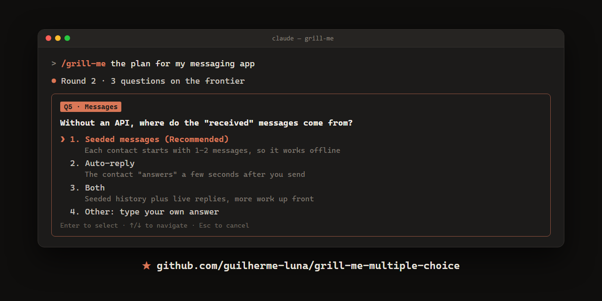

# grill-me (múltipla escolha)

[](https://claude.com/claude-code)
[](LICENSE)
[](https://github.com/guilherme-luna/grill-me-multiple-choice/stargazers)



🇬🇧 **[Read in English](README.md)**

Uma skill do [Claude Code](https://claude.com/claude-code) que te entrevista sem parar sobre um plano até todas as decisões estarem resolvidas, mas em vez de um bloco de texto, cada pergunta vem numa **caixa de múltipla escolha** que você responde com um clique.

**O jeito mais fácil de ter o grill-me com perguntas de múltipla escolha: um comando para instalar, sem mexer em configuração.**

Baseada na [`grill-me`](https://github.com/mattpocock/skills/tree/main/skills/productivity/grill-me) do [Matt Pocock](https://github.com/mattpocock), com licença MIT. Perguntas clicáveis já foram pedidas várias vezes no repositório original ([#798](https://github.com/mattpocock/skills/issues/798), [#643](https://github.com/mattpocock/skills/issues/643)), mas como dependem da ferramenta usada, ficam fora da skill oficial. Este repositório entrega isso como um plugin pronto para instalar.

## O que muda

Na original, cada rodada vem como texto no chat, com uma resposta recomendada que você aceita digitando "sim". Nesta versão, toda rodada usa a ferramenta **AskUserQuestion** do Claude Code:

- As perguntas aparecem numa **caixa de seleção**, não como texto solto.
- Cada pergunta tem as opções **a, b e c**, mais a **(d) "Other"**, onde você escreve sua própria resposta.
- A opção recomendada vem **sempre primeiro**, marcada com "(Recomendado)".
- Cada opção tem uma explicação curta das vantagens e desvantagens.
- A numeração continua entre as rodadas (Q1…Q12…).
- As perguntas vêm no idioma em que você escreve.

O resto é igual: a **árvore de decisões**, a **fronteira** de perguntas que já dá para fazer, o Claude pesquisando os fatos sozinho, e nada é executado até você confirmar que vocês chegaram a um entendimento comum.

### Por que não só um trecho no `CLAUDE.md`?

Dá para ter as rodadas clicáveis colando algumas linhas no seu `CLAUDE.md` (veja o [#798](https://github.com/mattpocock/skills/issues/798)). Funciona bem se você não se importa de editar configuração. Este plugin é para quando você prefere:

- instalar com **um comando** e remover com a mesma facilidade;
- deixar o seu `CLAUDE.md` limpo e não mexer em projetos compartilhados;
- ter os extras: perguntas no seu idioma, numeração que continua entre as rodadas e um prós e contras em cada opção.

## Instalação

**Como plugin (recomendado)**, dentro do Claude Code:

```
/plugin install grill-me-multiple-choice --marketplace guilherme-luna/grill-me-multiple-choice
```

Em versões mais antigas do Claude Code, adicione o marketplace antes:

```
/plugin marketplace add guilherme-luna/grill-me-multiple-choice
/plugin install grill-me-multiple-choice@grill-me-multiple-choice
```

**Manualmente**, copie as duas skills para a sua pasta de skills (a `grill-me` é só um atalho que chama a `grilling`).

macOS / Linux:

```bash
git clone https://github.com/guilherme-luna/grill-me-multiple-choice.git
cp -r grill-me-multiple-choice/skills/* ~/.claude/skills/
```

Windows (PowerShell):

```powershell
git clone https://github.com/guilherme-luna/grill-me-multiple-choice.git
Copy-Item -Recurse -Force grill-me-multiple-choice\skills\* "$HOME\.claude\skills\"
```

Reinicie o Claude Code se o `/grill-me` não aparecer.

> ⚠️ Se você já tem a `grill-me`/`grilling` do Matt Pocock instalada, esta versão substitui a dele.

## Uso

```
/grill-me o plano do meu app de mensagens
```

O Claude mapeia as decisões e faz cada rodada como uma caixa de seleção:

```
Q5 – Sem uma API, de onde vêm as mensagens "recebidas"?
  (a) Mensagens pré-carregadas (Recomendado) — cada contato começa com 1–2 mensagens
  (b) Resposta automática — o contato "responde" depois que você envia
  (c) As duas
  (d) Other: ____________
```

⭐ **Se te ajudou a pensar melhor num plano, deixa uma estrela: isso ajuda outras pessoas a encontrarem o projeto.**

## Arquivos

```
.claude-plugin/       # manifestos do plugin e do marketplace
skills/
  grill-me/SKILL.md   # atalho /grill-me → chama "grilling"
  grilling/SKILL.md   # a lógica da entrevista (modificada)
```

## Licença

[MIT](LICENSE). Skills originais © Matt Pocock; mudanças de múltipla escolha © Guilherme Cardoso.
